


  

**💼 Open to Full-Stack & Software Engineer roles** — remote. 
📍 Based in Fresno, CA

 

 

## 👋 The 10-second version

> I'm a full-stack developer who ships **production software that runs businesses every day.**
> At a wholesale food distributor I've built and operate **~20 internal systems** — a field-sales platform, a full CMMS that replaced a paid SaaS, warehouse boards, food-safety compliance tools — plus **live client websites through my freelance studio, [LocalFix](https://localfix.now)** (including a government agency's public site), and **a complete IPTV player for Android TV / Fire TV** built from scratch.
>
> **Node.js · React · React Native · TypeScript · Python · SQL** — and I bring AI in where it actually earns its place.


 

## 🛠️ Featured Work

> Production software running real operations — not side projects gathering dust.

<table>
<tr>
<td colspan="2" valign="top">

### 📺 ShoushaTV
**A complete IPTV player for Android TV / Fire TV — built from scratch, end to end.**  
Remote-only 10-foot UI on **Expo + react-native-tvos**: live TV with instant zapping, an XMLTV guide with **catch-up replay**, and **Skip Intro / Next Episode that learns each show**. A **self-healing stream-recovery state machine** means never a silent black screen, and the player swaps engines per platform (**ExoPlayer** on TV, **libVLC** on iPhone, where AVPlayer can't decode most IPTV streams) behind one surface API. Fire TV, Android TV, iPhone, and web. **77 unit tests.**
📦 Public downloads: [shoushatv-releases](https://github.com/shousha401/shoushatv-releases)

`React Native (Expo)` `TypeScript` `react-native-tvos` `ExoPlayer` `libVLC` `TanStack Query` `MMKV`

</td>
</tr>
<tr>
<td width="50%" valign="top">

### 🧭 Breadcrumb — Field Sales Platform
**The sales team's command center: ~15 reps, 19 territories, ~10,000 accounts.**  
Live territory map, team feed, offline-first check-ins, visit plans, cadence tracking, and win-back / new-opening leads mined from licence data. **1,196 backend + 379 frontend tests**, plus a 225-screenshot reachability sweep across five device profiles.

`Node.js` `Express` `React`

</td>
<td width="50%" valign="top">

### 🔧 CMP+ — In-house CMMS
**Replaced the ManagerPlus maintenance SaaS — and the company owns it now.**  
Work orders with a one-decision-per-screen wizard, parts inventory on an **append-only stock ledger** (moving-average cost, integer cents), purchasing & receiving, nightly auto-generated preventive maintenance, per-building role scoping, CSV importers — and unit tests on every money path.

`Node.js` `Express` `React` `Vite` `SQLite`

</td>
</tr>
<tr>
<td width="50%" valign="top">

### 🥩 ShoushaBox
**Replaced a paper workflow that ran the cut floor.**  
Pulls live orders from the ERP, assigns cuts to the team, and tracks start/end times on warehouse TVs — now the floor's daily source of truth. Bilingual EN/ES with Sato label printing.
Public code: [warehouse-ui](https://github.com/shousha401/warehouse-ui) · [warehouse-backend](https://github.com/shousha401/warehouse-backend)

`Node.js` `React` `Vite` `SQLite` `MSSQL`

</td>
<td width="50%" valign="top">

### 🛰️ Shousha-Hub — Fleet Launchpad & Watchtower
**One front door for every internal tool — and the monitor that watches them all.**  
Live status probes on the whole fleet, a read-only ops dashboard, incident emails with recovery notices, and an ideas/help inbox for the floor — fronted by a **Three.js 3D scene** where tiny agents work each tool's *real* health data.

`Node.js` `Express` `Three.js` `PM2`

</td>
</tr>
<tr>
<td width="50%" valign="top">

### 🖥️ Internal IT Platform
**One app that replaced a paid SaaS contract — and kept growing.**  
Began as a printer/toner SNMP monitor (45 printers, email alerts, dashboards) and became an all-in-one: helpdesk ticketing, an **AI-powered EN→ES PDF translator**, QR asset inventory, and usage analytics.

`Node.js` `Express` `SQLite` `SNMP` `OpenAI`

</td>
<td width="50%" valign="top">

### 🚚 Delivery Verification System
**Mobile proof-of-delivery for drivers (Android via Intune).** *(in development)*  
Barcode capture, offline-first sync, route-conflict prevention, a manager dashboard, and an automated 4 AM ERP sync.

`React Native (Expo)` `Node.js` `PostgreSQL` `Azure`

</td>
</tr>
</table>

 

## ⚙️ How it all connects

  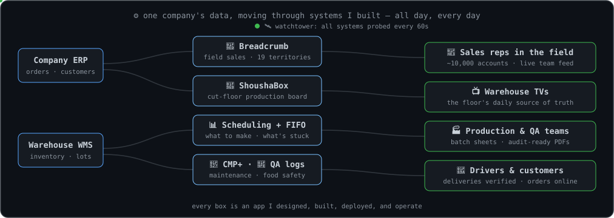

 

## 🌐 Client Work — live on the internet

> Shipped under my freelance studio, **[LocalFix](https://localfix.now)** — web design, workflow automation, and AI chatbots for Central Valley businesses and beyond.

<table>
<tr>
<td colspan="2" valign="top">

### 🧰 LocalFix — the studio itself
**My freelance practice, and its site is the demo reel.**  
A raw-WebGL "gooey" shader hero (nine SDF metaballs, scroll-driven, written against Three.js directly — no react-three-fiber overhead), GSAP + Lenis scroll choreography, and a **custom Vite SSR prerender pipeline** that writes per-route SEO heads at build time instead of reaching for Next.js. Respects `prefers-reduced-motion` throughout.
🔗 [localfix.now](https://localfix.now)

`React 19` `TypeScript` `Three.js (WebGL)` `GSAP` `Vite SSR` `Tailwind`

</td>
</tr>
<tr>
<td width="50%" valign="top">

### 🏛️ Kings County Water District
**The live public website of a California water agency.**  
Full redesign of an early-2000s site: responsive, bilingual EN/ES, accessibility-minded (WCAG 2.1), with a 2FA staff portal so the district publishes agendas, minutes, and board updates themselves — no developer needed.
🔗 [kingscwd.org](https://kingscwd.org)

`React 19` `TypeScript` `Vite` `Tailwind` `Supabase`

</td>
<td width="50%" valign="top">

### 🧳 Pirata Goods
**Full e-commerce for a Cairo handcrafted-leather brand.**  
Storefront, cart, cash-on-delivery checkout with server-side price validation, and a complete admin CMS: drag-and-drop product photos with on-page compression, order workflow, magic-link auth with TOTP 2FA.
🔗 [piratagoods.com](https://piratagoods.com)

`Next.js 15` `TypeScript` `PostgreSQL (Neon)` `Drizzle`

</td>
</tr>
<tr>
<td width="50%" valign="top">

### 🪡 Refined Stitchery
**Boutique storefront with live Stripe checkout for a UK sewing business.**  
Owner-managed catalogue, photos, and content; paid orders recorded through deduplicated Stripe webhooks; GDPR-conscious cookieless analytics.
🔗 [refinedstitchery.co.uk](https://www.refinedstitchery.co.uk/)

`React 19` `TypeScript` `Stripe` `Supabase` `Vercel`

</td>
<td width="50%" valign="top">

### 🥎 Bullard Knights Softball
**Static-fast team site for a Fresno high-school program.**  
Near-zero JavaScript, calendar downloads per event, and automated QA sweeps: layout overflow at 14 viewports and WCAG contrast in both themes, enforced by scripts.
🔗 [bullardsoftball.com](https://bullardsoftball.com)

`Astro` `TypeScript` `Tailwind`

</td>
</tr>
<tr>
<td width="50%" valign="top">

### 🧑‍🍳 Meat Up — Staff & Tips
**Scheduling and tip sheets for a two-store butcher shop — live in production.**  
Shift scheduling with deny-by-default eligibility and authorization rules, plus a tip engine that's *property-tested*: 1,000 randomized cases prove tip shares always sum to the pool, to the cent. 358 tests, automated off-site backups with a rehearsed restore runbook.

`Node.js` `Express` `React` `TypeScript` `SQLite` `Tailwind`

</td>
<td width="50%" valign="top">

### 🛒 Meat Up — Online Ordering
**Guest pickup ordering for the same shop — a contract-first build.** *(in development)*  
Every feature traces to a numbered spec contract; **589 tests** where every guard was first demonstrated failing; CI with a real Postgres service and SHA-pinned actions. Deployed to staging; Square payments are the next milestone.

`Node.js` `Express 5` `PostgreSQL` `React` `Vite` `Zod`

</td>
</tr>
</table>

### Also running in production

**Ask JD** — on-prem LLM + RAG proof-of-concept over the company ERP/WMS (`FastAPI` `Ollama` `Postgres`) · digital food-safety receiving log with a rule engine, review queue, and audit-ready PDFs · USDA-compliance recipe builder · production scheduling with FIFO-violation detection · a fewest-pallet blend solver · a GS1-128 label tool whose hand-written barcode encoder was verified against 61,000+ payloads · supplier compliance tracker · shelf-life QA tracking · break-compliance monitor · a WebRTC video-calling app with CallKit

 

## 🧰 Tech Stack


<b>×N</b> = how many of the projects on this page ship with it

 

## 🧊 Contributions

  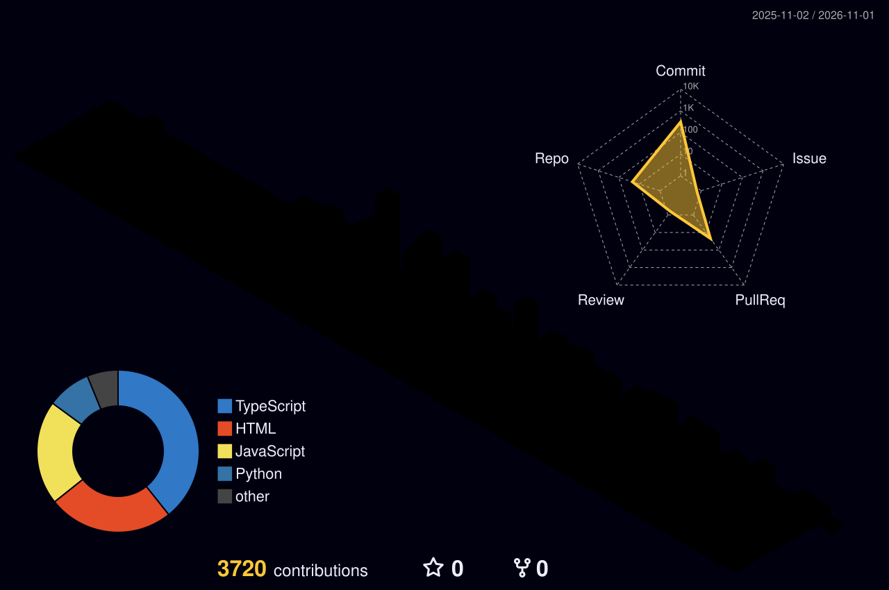

 

## 🚀 Currently Exploring

Bringing AI into line-of-business software — where LLMs genuinely help in operations, inventory, and customer-facing tools, **and where they don't.** Two live examples: the EN→ES translator in my IT platform (AI doing real, boring, useful work), and **Ask JD** — an on-prem LLM + RAG proof-of-concept that answers natural-language questions against the company's ERP and warehouse data, read-only, with a tiered PII model.

The interesting question isn't *"can we add AI to this?"* — it's *"should we?"*

 

## 📫 Let's talk

I'm open to full-stack and software engineering roles. The fastest way to reach me:

  

